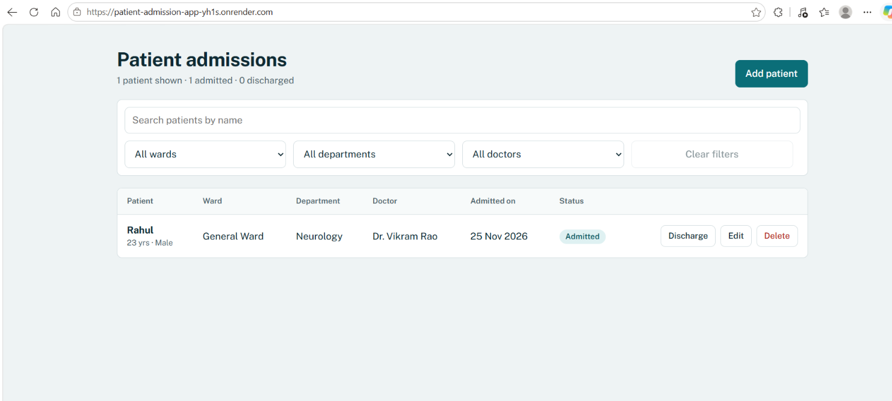
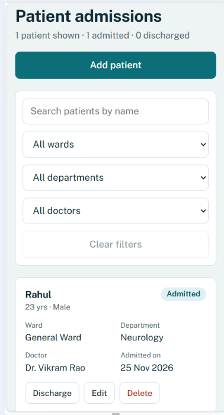
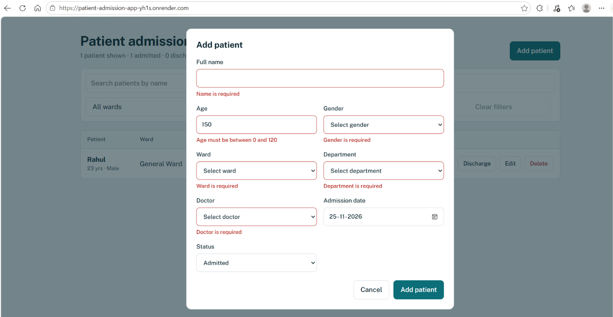

# Patient Admission Management App

A web app for hospital staff to manage admitted patients: add, view, search, filter, edit, delete (with confirmation) and discharge. Responsive on mobile, tablet and desktop.

Live app: `https://patient-admission-app-yh1s.onrender.com/`
Repo: `https://github.com/raviteja-36/patient-admission-app`

## Tech stack

| Layer | Technology |
|-------|-----------|
| Frontend | React 18 (Vite), plain CSS |
| Backend | Python 3.12, FastAPI, SQLAlchemy, Pydantic |
| Database | PostgreSQL in production (Neon), SQLite file locally. Both persist across restarts |
| Hosting | Single Docker service on Render (the backend also serves the built React app) |

## Features

1. Add a patient
2. List all patients (table on tablet/desktop, cards on mobile)
3. Filter by Ward, Department and Doctor
4. Search by name
5. Edit a patient
6. Delete with a confirmation dialog
7. Mark as Discharged
8. Responsive, accessible layout

## Validation (frontend and backend)

| Field | Rule |
|-------|------|
| Name | Required, letters and spaces only |
| Age | Required, whole number 0 to 120 |
| Gender, Ward, Department, Doctor | Required, must be from the list |
| Admission date | Required, cannot be in the future |

The backend returns HTTP 422 with a clear message, for example:
`{"message": "Invalid data: Age must be between 0 and 120", "errors": {"age": "Age must be between 0 and 120"}}`.
Per-field errors are shown under each input in the form.

## API

| Method | Path | Purpose |
|--------|------|---------|
| GET | `/api/options` | Dropdown values |
| GET | `/api/patients?search=&ward=&department=&doctor=` | List / search / filter |
| POST | `/api/patients` | Add |
| PUT | `/api/patients/{id}` | Edit |
| PATCH | `/api/patients/{id}/discharge` | Mark discharged |
| DELETE | `/api/patients/{id}` | Delete |

Interactive API docs are at `/docs` when the server is running.

## Run locally

Requirements: Python 3.10+ and Node 18+.

```bash
# 1. Backend
cd backend
python -m venv .venv && source .venv/bin/activate     # Windows: .venv\Scripts\activate
pip install -r requirements.txt
python -m app.seed                                    # optional sample data
uvicorn app.main:app --reload --port 8000

# 2. Frontend (new terminal)
cd frontend
npm install
npm run dev                                           # http://localhost:5173 (proxies /api to :8000)
```

Backend tests: `cd backend && pip install -r requirements-dev.txt && pytest test_api.py`

## Deploy (Render + Neon)

1. Create a free Postgres database on Neon (neon.tech) and copy its connection string.
2. On Render (render.com): New, Web Service, connect this repo, runtime **Docker**.
3. Add environment variable `DATABASE_URL` with the Neon connection string. Set it in Render only, never in the repo.
4. Deploy. The live URL serves both the React app and the API.

## Screenshots

Add images to a `screenshots/` folder:





## Project structure

```
backend/app/   main.py (routes), schemas.py (validation), database.py (model), options.py (dropdown lists)
frontend/src/  App.jsx, api.js, validation.js, components/ (PatientForm, PatientList, Filters, ConfirmDialog, Modal)
Dockerfile     builds React, then runs FastAPI serving it
```
